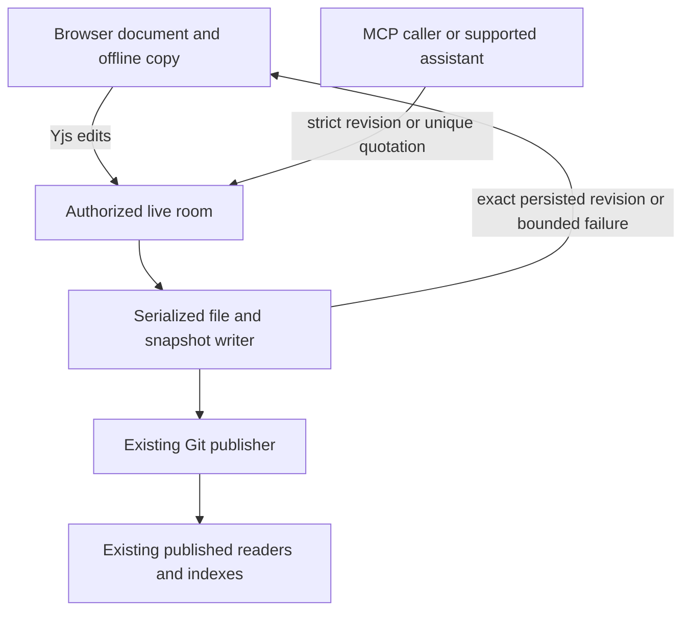
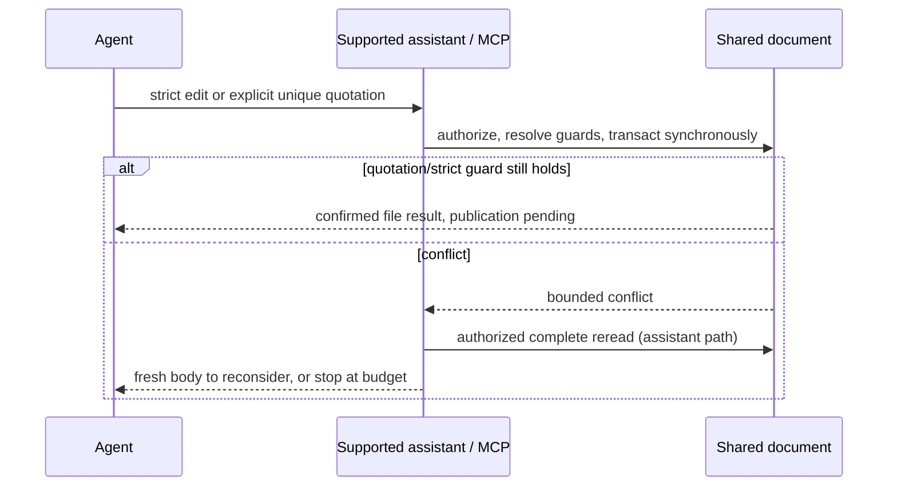
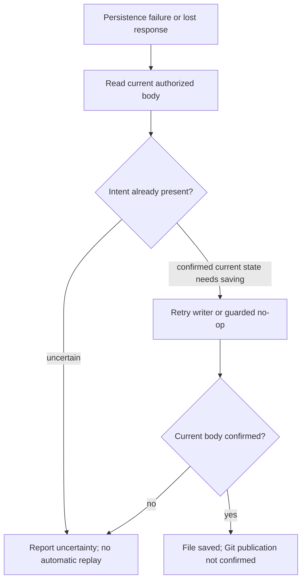

# Guarded shared document editing for agents

## Goal Capsule

**Objective:** Authorized bots and browser users can edit shared documents without silent overwrites, see whether their text reached durable files, and recover from conflicts or storage failures through supported Folio flows.
**Means:** Strict body revisions, explicit exact-quotation edits, document persistence acknowledgements and bounded supported-caller recovery (KTD1–KTD3, KTD6–KTD8).
**Authority:** The owner's request and repository invariants govern. Implementation and local verification were initially authorized. The owner subsequently authorized pushing this feature branch and maintaining draft PR #2 against `deployment`, with babysitting disabled, plus merging the current deployment base into this branch without rewriting published history. PR merge, deployment, live caller migration and production permission/credential changes remain excluded.
**Execution profile:** One feature branch initially based on deployment commit `2d2ae63`, now integrating deployment `971aaf4` by merge and preserving its newer upstream conflict recovery. The orchestrator implements sequentially and returns behavior and evidence for owner review. Any later release requires owner approval.

---

## Product Contract

### Summary

Expose a bounded single-document editing contract through REST and MCP. Bots need no repository clone or raw Yjs protocol. Published Markdown/Git and existing downstream readers remain the record of publication.

### Problem Frame

`editDocBody` currently deletes and reinserts the entire live body. MCP and nearby comments promise merging that does not protect browser edits received after a caller's read. Separate bot clones also require coordinated synchronization and do not reserve a page.

### Requirements

**Shared editing**

- R1. A document read returns a revision of exactly the returned LF-normalized Markdown body, excluding frontmatter.
- R2. Strict `update_page` whole-body replacement and offset-edit requests require the read revision. Stale writes fail with bounded conflict metadata and no mutation or attribution change. The additive exact-quotation primitive follows R14 instead; it does not weaken this strict contract.
- R3. Targeted edits validate nonoverlapping ranges and their exact expected text against one revision, then apply all changes atomically to Y.Text. Preserve unrelated CRDT characters and frontmatter.
- R4. Validation and mutation have no intervening await. Cold writes restore the existing snapshot before editing; browser/offline state and conflict recovery remain intact.

**Access and completion**

- R5. REST and MCP keep existing roles, inherited page restrictions, `.agent` rules and read/write scopes. Hidden or excluded content gains no path-based bypass. Inputs, edit counts and resulting body sizes are bounded.
- R6. A successful write reports the accepted revision, whether content changed, and file persistence separately from pending Git publication. A failed persistence attempt must not report success; a lost response requires readback and reconciliation rather than an unsafe blind retry.
- R7. Record the connected user's existing Git identity only for accepted changes. No-op and conflict calls do not claim authorship. Existing quiet-period commits keep their last-editor semantics.
- R8. Legacy unguarded MCP callers and token REST body writers receive a useful precondition error. Preserve the existing browser cookie PUT compatibility explicitly as an unguarded legacy operation, without safe-merge claims. Guarded requests use a body-only contract; metadata APIs remain separate.

**Integration boundary**

- R9. Keep existing structured multi-file note publication, request journals, receipts, selected staging, source protections and approvals. A page/index/log sequence through single-page APIs is not an atomic publisher.
- R10. Document a staged migration and verification procedure that preserves private scope separation and published readers/indexing. No live bot switches paths in this work.

**Save clarity and usable recovery**

- R11. Browser document UI distinguishes connection, server receipt, current-body file/snapshot confirmation and unverified Git publication. Old save receipts never confirm newer typing or pure deletes. Offline state overrides stale socket state.
- R12. Storage failure remains visible until confirmed recovery. A retry requests persistence of the existing document, never a replacement/reseed. Keep the browser's recoverable document copy and leave warning while file persistence is unconfirmed; preserve share-session privacy.
- R13. A supported agent caller has bounded conflict recovery with complete authorized reread, explicit reconsideration and a useful terminal stop. Unknown outcomes do not trigger mutation replay. Do not expose revisions from incomplete recovery reads.
- R14. An additive exact-quotation editing primitive lets a caller explicitly replace one unchanged unique passage in the current body while unrelated typing continues. No fuzzy match, ordinal occurrence, empty match, hidden relocation of existing offset edits or silent whole-body fallback. Consume the source quotation on changes so replay cannot normally duplicate an insertion.

### Scope Boundaries

The increment covers document bodies only. Tables, forms, boards, bases, metadata changes, history restore and structural operations retain their existing contracts. Considered and not built: raw bot Yjs clients (unnecessary protocol burden), automatic rebasing of stale ranges or whole replacements (could change intent), a new multi-page journal/publisher (existing publisher already provides it), per-edit Git commits (would change publication policy), and durable body request-id storage (content guards plus readback limit replay; durable exactly-once receipts remain with the existing publisher).

### Deferred to Follow-Up Work

External production adapters and live migration, bot credentials/configuration, approval-aware staging before Folio's auto-publishing spaces, atomic multi-page transactions, and replacing legacy cookie body PUT are follow-up work. Before routing a bot, approve the destination's existing automatic Git publication policy; this API is not a draft approval queue.

---

## Planning Contract

### Key Technical Decisions

- KTD1. **Content revision, bound to page and exact body.** Read and write against the same fully restored Y.Text, including cold reads; file-only reads can differ from a snapshot in final newline or pending edits. Hash the page id and returned body with a version prefix. Do not reuse `fileBodyHash(docFileBody(...))`, which treats final newlines differently. A revision is an opaque content precondition, not a Git SHA or Yjs vector; identical body content can recur.
- KTD2. **One guarded editing primitive.** Extend `update_page` and REST document PUT with `expectedRevision` and mutually exclusive `markdown` or `edits`. Each edit carries UTF-16 `from`, `to`, `expectedText`, and replacement `text`; ranges refer to the same original body. Refuse overlap, duplicate insertion positions, mismatches and surrogate splits. A stale revision always conflicts, even for unrelated changes.
- KTD3. **Use restored live rooms for cold reads and edits.** Reuse `ensureDocSeeded`, do not delete snapshots or disconnect clients. Snapshot lookup or decode failure must fail acquisition, remove the failed room and leave stored state intact; file seeding requires confirmed snapshot absence. Check revision and all edit guards and transact synchronously. Whole replacements retain common prefix/suffix identities instead of recreating the whole body. Serialize API persistence with the existing writer, and reclaim API-only rooms safely after use; await closing-room persistence before a new seed and test lifecycle races.
- KTD4. **Honest completion and retry behavior.** Await verified file/snapshot persistence, retain normal retries on failure, and return an error that says an accepted edit may already be live. The accepted revision describes the operation's result; later browser typing can already have advanced it. Exact retries with an old revision conflict after a change; reread before deciding whether to resubmit. No-op requests do not schedule a commit.
- KTD5. **Keep existing security and publication ownership.** Authorization remains in the existing resolvers. Frontmatter is never submitted through guarded editing. No API response claims remote publication or indexing; existing authorized Sync and published-file verification remain required. Existing multi-file publisher remains authoritative for structured saves.

- KTD6. **Server-originated document persistence receipts.** Add a versioned document-only collaboration message, separate from Yjs roots and sync/awareness. The already-authorized socket receives pending/failure/success and the exact body revision captured before a successful file write and snapshot save. A document update invalidates current-body confirmation; an older successful save may never mark newer content saved. Initial connect/reconnect starts unconfirmed and requests a normal serialized flush. Failures reveal no storage paths. Manual retry is a bounded writer request over that authorized socket, not a content mutation.
- KTD7. **Browser confirmation by exact content.** Compare the local LF body with the persisted revision using the same versioned hash input. Use asynchronous browser hashing with generation checks; failure/unavailable status is unconfirmed. Combine it with server receipt before clearing document offline copies. Keep existing boards/tables behavior separate. Show visible file-save/failure text, an accessible retry action and separate Git-publication uncertainty; navigator offline events override the connection tooltip.
- KTD8. **Explicit intent and bounded reconsideration.** Preserve strict `update_page` unchanged. Add `replace_page_text` over MCP (also available to the existing Agent-mode assistant): replace exactly one unique, nonempty source quotation wherever it occurs in this page's current body. After a changed replacement the entire resulting body must no longer contain the source quotation, including boundary recombination. Count overlapping matches. Pure EOF appends that preserve their source passage use the existing strict guarded-range flow. Validate and transact on the same restored room with no await, reusing persistence and attribution. Missing/ambiguous quotations stop. This is explicit location-independent intent, not proof of semantic continuity after surrounding text changes. The assistant wrapper returns a fresh complete read on conflicts and permits at most two conflict responses per page/run before blocking further body writes. It never swaps revisions or automatically retries mutation after transport/503 errors. External clients receive the public tool/error contract; production caller adaptation is separate.

### High-Level Technical Design

```mermaid
sequenceDiagram
    participant Bot
    participant API as REST or MCP
    participant Room as Existing Yjs room
    participant File as Markdown and snapshot
    Bot->>API: Read authorized document
    API-->>Bot: Exact body and revision
    Bot->>API: Revision and replacement or guarded ranges
    API->>Room: Restore if cold; synchronous check and transaction
    alt precondition fails
        API-->>Bot: Bounded conflict; reread required
    else accepted
        Room->>File: Existing serialized persistence path
        API-->>Bot: Changed flag and accepted revision; publication pending
    end
```

Directional contract sketch: a write is `{expectedRevision, markdown}` or `{expectedRevision, edits: [{from, to, expectedText, text}]}`. No content or file paths are returned in conflicts. Compatibility depends on authentication: token body writes require the guard; legacy cookie body PUT remains explicitly unguarded.

Directional component sketch:



Save-state sketch:

```mermaid
stateDiagram-v2
  [*] --> Unconfirmed
  Unconfirmed --> Saving: connected receipt
  Saving --> FileSaved: persisted revision matches local body
  FileSaved --> Saving: body changes
  Saving --> SaveFailed: file or snapshot failure
  SaveFailed --> SaveFailed: more typing or failed retry
  SaveFailed --> FileSaved: successful matching flush
  FileSaved --> Unconfirmed: disconnect
  SaveFailed --> SaveFailed: reconnect; confirmation resets, warning retained
```



Connection and current-body confirmation reset on reconnect independently of a known storage failure. Keep that failure warning until a successful persistence receipt matches the current local body.

Caller protocol sketch:



Recovery lifecycle sketch:



### Evidence and Assumptions

Confirmed source: `collab.ts` seeding, snapshot recovery, body replacement and persistence; `storage.ts` file lock and frontmatter-preserving write; `mcp.ts` and `routes.ts` existing checks; `pageDoc.ts` live-first reads; `mcpOutputSchemas.ts` structured reads. `contentSafety.test.ts`, `mcp.test.ts`, `shareCollab.test.ts` and `pageAccessInherit.test.ts` provide real storage/auth/socket seams. The deployment tree matches the stated tested source. No CE model/provider override is configured in this checkout.

Local patterns establish the selected approach; no new dependency or external protocol is introduced. Private operational references were inspected read-only and supply only the generic integration constraints in R9–R10; no operational identifiers belong here.

---

## Implementation Units

### U1. Shared contract and guarded body operations

**Goal:** Define and validate exact body editing. **Requirements:** R1–R5, R8. **Dependencies:** None.
**Files:** `shared/contracts.ts`, new `server/documentEdits.ts`, `server/documentEdits.test.ts`.
**Approach:** Define shared request/result schemas first. Implement revision and pure range planning with explicit limits and bounded typed errors. Use one resulting change set for live mutation.
**Patterns:** Existing Zod contracts and ETag conflict precedents.
**Test scenarios:** Exact final-newline and page-id revisions differ; stale input is refused; out-of-order nonoverlapping ranges preserve text; repeated expected strings use explicit ranges; overlap, duplicate insertions, surrogate splits, malformed requests and oversize results fail; no-op produces no change.
**Verification:** Focused pure tests establish the mutation decision independently of storage. They do not prove persistence or socket delivery.

### U2. Live-room integration and external interfaces

**Goal:** Make guarded writes consistent and durable through REST and MCP. **Requirements:** R1–R8. **Dependencies:** U1.
**Files:** `server/collab.ts`, `server/pageDoc.ts`, `server/routes.ts`, `server/mcp.ts`, `server/mcpOutputSchemas.ts`, new `server/documentEditing.test.ts`, affected existing tests.
**Approach:** Add the safe primitive alongside internal legacy writers, update read schemas, gate legacy bot calls, and expose the same edit contract in both interfaces. Preserve metadata-only browser calls and source exclusions. Observe real persistence failures, rather than treating void `flushDoc` as proof. Capture attribution at acceptance.
**Execution note:** Start with regression cases using actual Yjs and the repository's PostgreSQL/files/socket fixtures.
**Test scenarios:** Two bot writes from one revision yield one winner; browser edits before checking reject the bot; browser updates during awaited preparation cannot be overwritten; targeted edits preserve other text/frontmatter; delayed/offline edits survive Yjs merge; cold writes/readback survive restart; stale/no-op calls preserve attribution; persistence failure is not reported as saved; read-only scope/private/ancestor restrictions/`.agent` deny reads or writes without content leakage; REST and real MCP transport return compatible results.
**Verification:** Targeted server tests and existing collaboration/access regressions. Real browser validation covers a bot edit appearing in an open editor with typing retained; container validation covers the runtime when available.

### U3. Integration guide and owner review evidence

**Goal:** Make the increment usable without implying live migration. **Requirements:** R9–R10 and compatibility/completion in R6–R8. **Dependencies:** U2.
**Files:** `docs/MCP.md`, `docs/FEATURES.md`, `docs/LIMITATIONS.md`, `docs/HANDOFF.md`, `DEV-PLAN.md`, `CHANGELOG.md`, `README.md` fork inventory, assistant tool guidance, new `docs/AGENT-EDITING.md`.
**Approach:** Document exact requests, errors, retry/readback and pending publication. Describe allowlisted page resolution, preserved originals/private scopes, published Git readers/indexes, multi-page deferral and existing note receipts/approvals. Record verification and missing prerequisites in a local evidence artifact.
**Test expectation:** Documentation has no runtime behavior; verify examples against schemas and remove old merge guarantees. Assistant guidance must match tools/list.
**Verification:** Simplification, independent code review, affected tests, typecheck and build; inspect final diff for private identifiers and unintended production changes.

### U4. Document persistence signal and browser recovery

**Goal:** Deliver truthful file-save/failure/recovery states without changing document identities. **Requirements:** R4–R7, R11–R12. **Dependencies:** U1–U2.
**Files:** `shared/contracts.ts`, `server/collab.ts`, existing collaboration tests, `web/src/app/collabFileStatus.ts` and tests, `web/src/editor/collab.ts`, `web/src/editor/index.tsx`, editor CSS/i18n, `web/src/app/collabOffline.ts`, `web/src/app/offline/syncEngine.ts` and their existing tests.
**Approach:** Implement KTD6–KTD7. Wire the persistence signal through the actual authorized document socket, UI and both active-session and closed-page/headless offline cleanup predicates. Document copies and dirty records clear only when server receipt and exact current-body file/snapshot confirmation both hold. Pass the dirty record kind into headless flushing so document confirmation does not change boards/tables behavior. Retain all Y.Doc roots, identity and source/frontmatter behavior. Keep writer retry serialization and room leases.
**Execution note:** Start with failing persistence boundary, stale-success and browser status/fallback regressions.
**Test scenarios:**
- File and snapshot failure show an error despite connection/receipt, retaining the local fallback and unload warning.
- Closing a document during a storage failure leaves its recoverable copy and dirty record intact when the headless queue reconnects; cleanup occurs only after server receipt and matching file/snapshot confirmation. Boards/tables retain their existing cleanup contract.
- A save of body A finishing after typing body B cannot confirm B; pure deletion also invalidates confirmation.
- Retry while failed persists current text without reapplying edits; recovery clears failure only on matching success.
- Offline and reconnect discard obsolete status; status cannot be forged by another browser; share/public/read-only sockets preserve their existing access.
**Verification:** Targeted server/socket and browser status/offline regressions, real two-browser file fault/recovery, response loss and reconnect on the built container.

### U5. Exact-quotation tool and supported caller conflict recovery

**Goal:** Make targeted edits useful during unrelated typing and make retry loops terminate honestly. **Requirements:** R1–R10, R13–R14. **Dependencies:** U1–U2.
**Files:** `shared/contracts.ts`, `server/documentEdits.ts`, `server/collab.ts`, `server/mcp.ts`, `server/mcpOutputSchemas.ts`, `server/assistant/tools.ts`, existing document/MCP/assistant tests and shipped agent guidance.
**Approach:** Implement KTD8 as an additive opt-in tool. Existing offset/full-body requests retain strict staleness. Keep schema/output/tool-discovery metadata and Ask/public writer filters consistent. Use real assistant execute/MCP transport for recovery evidence; fixture-only retries are insufficient.
**Test scenarios:**
- Real supported caller replaces an unchanged unique quotation while another paragraph changes, preserving both authors' text and frontmatter.
- Changed, absent, duplicate or guard-preserving replacement stops without mutation; exact retry after a dropped response cannot duplicate the edit.
- Actual assistant strict conflict returns complete authorized fresh text, accepts a reconsidered fresh proposal, and stops further body writes after its page/run conflict budget.
- Truncated/denied/failed recovery reads reveal no usable revision; 503/transport failures never automatically replay mutation.
**Verification:** MCP SDK and actual returned assistant tools plus real browser typing/fault/readback scenarios; no paid model or production caller is required to prove those supported boundaries.

### U6. Integrated dogfood, review and same-PR handoff

**Goal:** Publish verified Folio-side behavior and exact external integration boundaries. **Requirements:** R9–R14. **Dependencies:** U4–U5.
**Files:** Existing plan, `docs/AGENT-EDITING.md`, `docs/MCP.md`, handoff/features/limitations/changelog and verification report; same draft PR body.
**Approach:** Repeat adversarial real-browser and supported-agent flows against the final isolated container. Run simplification, code review and affected gates, fix material findings, push without force to the same draft PR. Keep all operational examples neutral and private runtime artifacts untracked.
**Test scenarios:** Actual visible saving/failure/recovery and offline cues; bounded caller success/stop under ordinary typing; dropped responses and stale retries; regression of shared typing, selection/undo, MDX/comments and conflict recovery.
**Verification:** Exact commands/results and actual limitations in the verification report. No claim about a separate live sync incident without corroborated causal evidence.

---

## Verification Contract

Run `npm run typecheck`, focused Vitest tests for document editing plus affected MCP/access/collaboration and preserved Git-conflict regression tests, then `npm run build`. Use disposable synthetic fixtures only. PostgreSQL/Redis and browser/container prerequisites must be probed and failures reported; never substitute mock success for missing integration proof. Resolve material review findings and rerun affected checks. Do not run the full suite by default.

## Definition of Done

All units have concrete local changes and relevant verification evidence, including truthful browser file status and bounded supported-caller recovery. Guarded bot writes cannot overwrite a newer accepted body, preserve unaffected text and frontmatter, obey existing access, and report completion accurately. Durable documentation and migration guidance are public-safe. Simplification and code review are recorded, material findings resolved, abandoned code removed, and every missing validation prerequisite is named. Return the plan path, branch/worktree, changed paths and exact checks. The authorized branch and draft PR may be published for review. No PR merge, deployment, content publication or caller migration occurs.

## Owner-directed integration and adversarial verification

The initial implementation was reviewed and verified at `68c9901`. After draft PR creation the owner requested deeper end-user dogfooding and a merge of the advanced deployment base into the same branch. This extends verification rather than restarting the plan. Preserve upstream comments, MDX, writing rules, stable identifiers and its replacement for the earlier fork-only conflict patch.

The comment anchoring path must share guarded editing's room lease; its independent immediate-close implementation can otherwise destroy a room during an awaited API save. Prove the race before fixing it, retain comment anchor identities and arbitrary snapshot roots, and verify MDX source/frontmatter preservation. Rerun typecheck, targeted concurrency/access/comment/MDX/Git-recovery tests, build and the built-container browser pass on the integrated tree.

Use two independently authenticated real browser sessions with synthetic pages: same/different paragraph typing, bot edits during typing, stale reread/reconsider/retry, offline/reconnect/reload, undo/redo, selection/caret stability, dropped responses and a reversible isolated persistence fault. Keep API fixture-client evidence distinct from browser actions and from an actual integrated bot UI. Classify correctness regressions for local fixes; document larger pre-existing UX gaps without expanding the feature into a new save protocol or adapter. Record actual attempts and starvation friction. Publish only sanitized evidence in the existing verification report, excluding runtime/browser identities and tokens. Keep the PR draft pending owner review.

## Save-state and caller completion extension

The owner explicitly extended this same PR to implement the confirmed save-status and retry gaps end to end. Earlier documentation-only deferral of those gaps is superseded by U4–U6. Local Folio implementation, synthetic dogfood and feature-branch publication are authorized. A separate production bot adapter investigation belongs to its owner; no live sync incident is causally attributed to this PR.

Local evidence: server receipt already has its own acknowledgement tracker; `persistDoc` captures the file body before awaits but snapshots can include newer live edits; browser offline cleanup currently trusts receipt; supported assistant tools use a real MCP client and enforce Ask/public filters. No new dependency, migration, model/provider override, raw bot Yjs client or publication policy is needed. External research is unnecessary for these established local seams.
